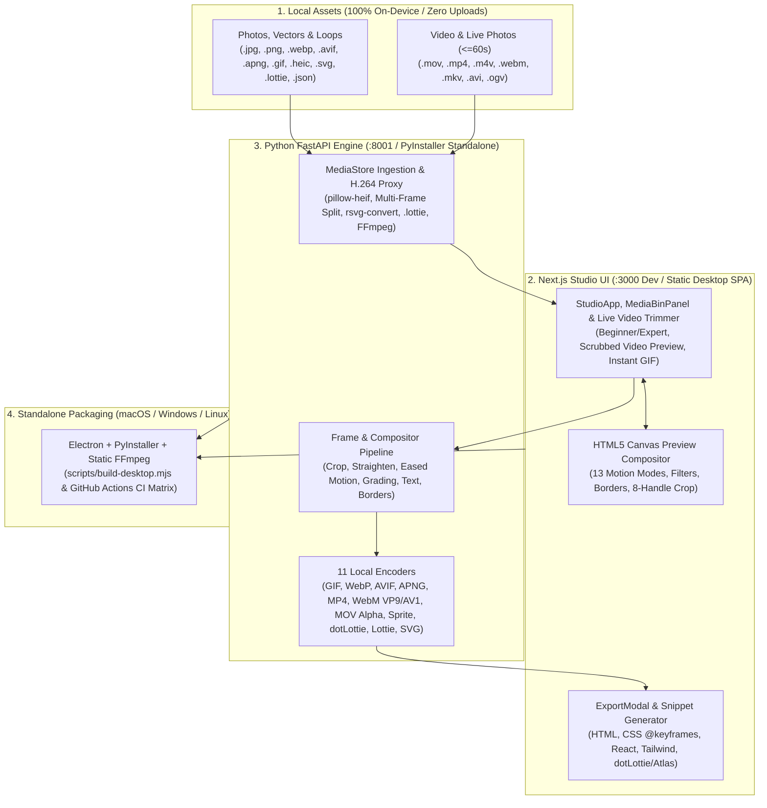

# GIF Studio

> **A private, open-source, local-first web & standalone desktop animation studio (macOS, Windows, Linux) that turns short videos (`.MP4`/`.MOV`/`.MKV`/`.AVI`/`.WebM`/`.OGV`), iPhone HEICs, Live Photos, SVGs, `.lottie`/Lottie JSON, and animated loops into GIFs, WebPs, AVIFs, APNGs, MP4/WebM/Safari HEVC-α videos, Sprite Sheets, dotLottie (`.lottie`), Lottie JSONs, and Animated SVGs — with a live `<video>` trimmer, Beginner & Expert controls, and ready-to-paste HTML/CSS/React/Tailwind snippets.**
>
> *Repository: **[github.com/EdgarsKalnins/gif-studio](https://github.com/EdgarsKalnins/gif-studio)** · Inspired by the local-first open-source studio architecture of **[Audio Guest Book Studio](https://github.com/EdgarsKalnins/audio-guest-book-studio)** by **[Edgars Kalniņš](https://github.com/EdgarsKalnins)** ([Momentbox.lv](https://momentbox.lv)).*

[](https://github.com/EdgarsKalnins/gif-studio)
[](LICENSE)
[](#-privacy--zero-telemetry-pledge)
[](#-build-standalone-desktop-apps-macos-windows-linux)
[](https://nextjs.org)
[](https://react.dev)
[](https://fastapi.tiangolo.com)
[](https://ffmpeg.org)

### GitHub Description & Topics
- **Repository Description**: `Local-first web & macOS/Windows/Linux desktop studio turning videos, HEICs, Live Photos, SVGs & dotLottie into GIF, WebP, AVIF, APNG, WebM, MOV alpha, Sprite Sheets, Lottie & SVG — 100% offline with zero telemetry`
- **Suggested Topics**: `gif-maker`, `video-to-gif`, `electron-app`, `cross-platform`, `dotlottie`, `avif`, `apng`, `webm`, `hevc-alpha`, `sprite-sheet`, `lottie`, `animated-svg`, `heic-to-gif`, `live-photo`, `ffmpeg`, `fastapi`, `nextjs`, `local-first`, `zero-telemetry`, `mit-license`

---

## Ask an AI Agent to Run or Build This Project

Working with an AI coding agent (**Claude Code**, **Cursor**, **Codex**, **Windsurf**, **Antigravity**, **OpenCode**, or **Gemini CLI**)? Hand this repository directly to your agent to run in dev mode or package into a standalone desktop app.

### Copy & Paste Prompt — Local Dev Workspace

```markdown
Run `./start.sh` from the repository root to launch both the Python FastAPI backend (`http://127.0.0.1:8001`) and Next.js frontend (`http://localhost:3000`). Verify the backend pipeline with `cd backend && .venv/bin/pytest -v`, verify frontend build and lint with `cd frontend && npm run build && npm run lint`, then open `http://localhost:3000`.
```

### Copy & Paste Prompt — Build Standalone Desktop App (`macOS` / `Windows` / `Linux`)

This workspace includes an **agentic build skill** ([`.agents/skills/build-app/SKILL.md`](.agents/skills/build-app/SKILL.md)) and unified packager ([`scripts/build-desktop.mjs`](scripts/build-desktop.mjs)):

```markdown
Use `/build-app` (or read `.agents/skills/build-app/SKILL.md`) and run `node scripts/build-desktop.mjs --target current` to package GIF Studio as a standalone desktop app with bundled Python engine, static Next.js UI, and offline FFmpeg/FFprobe binaries. To build macOS (.dmg), Windows (.exe), and Linux (.AppImage/.deb) installers together via GitHub Actions, run `node scripts/build-desktop.mjs --target all --ci`.
```

### Quick-Start Commands (Fresh Clone)

**Prerequisites (for source dev mode)**: Python 3.11+, Node.js 20+, and `ffmpeg` / `ffprobe` on PATH (plus optional `librsvg` for vector `.svg` rasterization). End users running packaged desktop releases need zero local dependencies.

```bash
# 1. Start local browser workspace (auto-creates backend/.venv & frontend/node_modules if missing)
chmod +x start.sh
./start.sh

# 2. Verify Python processing & API test suite (12 tests)
cd backend && .venv/bin/pytest -v

# 3. Verify Next.js production bundle & ESLint
cd frontend && npm run build && npm run lint
```

---

## Build Standalone Desktop Apps (macOS, Windows, Linux)

**End users never need Python, Node.js, Homebrew, or FFmpeg installed.** Each standalone installer packages:
- **Electron Chromium shell** ([`desktop/`](desktop/)) storing user projects in OS-native `app.getPath("userData")`
- **PyInstaller `--onedir` engine** ([`backend/desktop_entry.py`](backend/desktop_entry.py)) for fast native launch on a dynamically assigned `127.0.0.1` port
- **Static Next.js SPA bundle** (`NEXT_PUBLIC_STATIC_EXPORT=1`) served same-origin by FastAPI (zero CORS overhead)
- **Bundled static `ffmpeg` + `ffprobe` binaries** (`ffmpeg-static` + `ffprobe-static`) + bundled Public Domain stock & video samples

| Command | Output Targets | How It Runs |
| :--- | :--- | :--- |
| `node scripts/build-desktop.mjs --target current` | Native OS (`.dmg`/`.zip` on macOS, `.exe` NSIS + portable on Windows, `.AppImage`/`.deb` on Linux) | Builds PyInstaller, Next.js static export, icons & Electron bundle locally into [`desktop/dist/`](desktop/dist/) |
| `node scripts/build-desktop.mjs --target current --dir` | Unpacked local app bundle | Fast local build for `--smoke-test` verification without archive compression |
| `node scripts/build-desktop.mjs --target all --ci` | **macOS** (`arm64` + `x64`), **Windows** (`x64`), **Linux** (`x64`) | Dispatches [`.github/workflows/build-desktop.yml`](.github/workflows/build-desktop.yml) via `gh workflow run` |

> [!NOTE]
> All builds use ad-hoc signing (`identity: null`), so no paid Apple Developer or Windows EV certificate is needed to compile or share standalone builds.

---

## How to Use GIF Studio

1. **Import, Preview & Organize in the Responsive Media Bin**:
   - Drag and drop JPEGs, PNGs, `.HEIC`/`.HEIF` photos, `.SVG` vector graphics (rasterized via `rsvg-convert`), **`.lottie` (dotLottie)** containers and vector/raster **Lottie `.json`**, animated `.GIF`/`.WebP`/`.AVIF`/`.APNG` loops (auto-split into editable timeline frames), or short **`.MOV`/`.MP4`/`.M4V`/`.WebM`/`.MKV`/`.AVI`/`.OGV` video & Live Photo clips** (up to `60s` / `200MB`, with automatic 720p H.264 stream proxy caching) — or load **Try Sample Photos**, **15-Frame Motion Loop**, or **Try Sample Video**.
   - **Click any Grid card or List item to open the Lightbox Popup (`MediaPreviewModal`)** to view full-resolution images or play/scrub videos directly with `←` / `→` asset stepping before adding to the Timeline.
   - **Active Library vs. In Timeline**: Unused items stay bright in **Active Library** at the top, while items already in the Timeline dim and turn semi-transparent in **In Timeline (`✓ In Timeline · ×N`)** below. Removing a frame from the Timeline returns that asset immediately to **Active Library**.
   - **Drag to Timeline or Confirm Deletes**: Drag items directly from the Media Bin into any Timeline slot (or drop onto the Canvas), switch **Grid View** / **List View**, batch-append unused images with **+ Add All**, or safely confirm deleting single items or pruning unused storage via `ConfirmModal`.
2. **Trim Video, Shape Timeline & Track Live Playhead**:
   - Play and scrub video/Live Photo clips directly inside the interactive `<video>` **Trim Video & Make GIF** modal with live range looping, **Auto Full Clip** preset (`<= 4.5s`), playback speed (`0.5×`–`2×`), loop style (`Forward` / `Boomerang`), FPS/max-frame limits, plus **`Add Frames to Timeline`** or one-click **`Instant Export GIF`** — with extracted frames hidden from Media Bin clutter and cleaned up when deleting the parent video.
   - Watch the **live Timeline Playhead Progress Line** sweep smoothly across both the segmented interactive scrub track (click or drag to seek any frame) and the currently playing frame card (`Live` / `Playing #N`), reorder frames with drop-insertion guides or arrow buttons, `Shift+Click` / `Cmd+Click` to multi-select, batch-adjust duration, or decimate frames (`Keep 1/2`, `Keep 1/3`).
3. **Toggle Beginner or Expert Mode Across 6 Inspector Tabs**:
   - Switch between **Beginner Mode** (clean essentials + Quick Recipes) and **Expert Mode** (full curve, grading, typography, and encoder controls) directly from the header or inspector badge:
   - **Loop**: Pick Forward, Boomerang (ping-pong), Reverse, Seamless Fade loop, or Play Once; tune Repeat Count, Crossfade Loop overlap (`ms`), playback speed, end hold, per-frame transitions (`Crossfade`, `Slide`, `Zoom In`), or apply **Quick Recipes** (`Ken Burns`, `Boomerang`, `Retro VHS`).
   - **Motion**: Animate even a single still image across 13 motion styles (`Ken Burns`, `Zoom In/Out`, `Pan`, `Bounce`, `Shake`, `Pulse`, `Tilt Sway`, `Float Orbit`) with **Expert** easing curves (`Ease In-Out`, `Linear`, `Ease Out`, `Elastic`) and Focal Anchor `X/Y`.
   - **Crop & Frame**: Rotate/flip (`-90°/+90°`, `Flip H/V`), drag the 8-handle interactive Crop box (`Free`, `Canvas`, `1:1`, `4:5`, `16:9`, `9:16`), **Expert** Fine Straighten (`±15°`), wrap frames in **Clean**, **Polaroid**, or **35mm Film** borders, and customize corner radius, inner padding, and shadow.
   - **Effects**: Stack presets (`Vivid`, `Vintage`, `B&W`, `Sepia`, `Cool`, `Warm`, `Cyberpunk`, plus Expert `Duotone`, `Noir`, `Sunset`, `Pastel`) with Brightness, Contrast, Vignette, Film Grain, Saturation, Temperature, Sharpen, Chromatic RGB Split, Pixelate, Glitch/VHS, and Blur globally or per-frame.
   - **Text**: Add global or per-frame captions with color, outline stroke, backdrop pill, and **Expert** font family (`Sans`, `Serif`, `Mono`, `Display`), alignment, margin, opacity, shadow, and entrance animations (`Fade In`, `Slide Up`, `Typewriter`).
   - **Workspace Look & Theme**: Switch between **Day (Warm Paper)** and **Night (Studio Dark)** modes, or open **Style** in the header to customize accent ink (`Amber`, `Vermilion`, `Teal`, `Ink`), corner radius, typography pairing, and Phosphor icon weight/size.
4. **Export Locally in 11 Formats & Copy Web Dev Snippets**:
   - Pick from 3 format groups in the Export inspector (with **Expert** options for `Retina 2x`, Custom width, Custom Quality `1–100`, Lossless mode, Custom Video CRF, AV1/Auto codecs, Sprite padding, and Dither controls):
     - **Image**: `GIF` (2-pass FFmpeg palette quantization + Slack/Discord/X target sizing), `WebP` (Alpha), `AVIF` (ultra-compact animated AVIF with Alpha), `APNG` (lossless 24-bit + Alpha).
     - **Video Loop**: `MP4` (H.264 / AV1), `WebM` (`libvpx-vp9` with `yuva420p` alpha / AV1), `MOV α` (`hvc1` Safari Transparent HEVC Alpha).
     - **Web Dev Assets**: **Sprite Sheet** (`Horizontal Strip` or `Compact Grid` RGBA atlas + JSON), **dotLottie (`.lottie`)** ZIP container, **Lottie JSON** (Bodymovin `v5.9.0`), and **Animated SVG** (self-contained CSS `steps(1,end)` zero-JS keyframes).
   - Enable **Transparent Background** for alpha stickers, rounded corners, or transparent WebM/MOV α/AVIF/APNG/Sprite/SVG assets, then inspect live animated previews and copy ready-to-use **HTML**, **CSS**, **React**, **Tailwind**, or **Atlas JSON** snippets directly in **Export Ready**.

### Keyboard Shortcuts
- `Space`: Play / Pause live canvas preview
- `←` / `→`: Step backward / forward one frame
- `Cmd/Ctrl + Z` & `Cmd+Shift+Z`: Undo / Redo timeline & effect history (up to 40 steps)
- `Shift + Click`: Multi-select timeline range for batch editing
- `Delete` / `Backspace`: Remove selected timeline frames (with safety confirmation)

---

## Bundled Public Domain & CC0 Sample Stock

GIF Studio ships with offline public-domain photography and historical motion assets inside [`backend/samples/`](backend/samples) so every user can explore motion, filters, framing, and export codecs immediately:

| Asset | File | Attribution | License | Source |
| :--- | :--- | :--- | :--- | :--- |
| Apollo 8 *Earthrise* (1968) | [`nasa_earthrise.jpg`](backend/samples/nasa_earthrise.jpg) | NASA | Public Domain | [Wikimedia Commons](https://commons.wikimedia.org/wiki/File:NASA-Apollo8-Dec24-Earthrise.jpg) |
| Mars Sunset — *Spirit* Rover | [`nasa_mars_sunset.jpg`](backend/samples/nasa_mars_sunset.jpg) | NASA / JPL-Caltech | Public Domain | [Wikimedia Commons](https://commons.wikimedia.org/wiki/File:MarsSunset.jpg) |
| Vintage Film Camera Shelf | [`vintage_camera.jpg`](backend/samples/vintage_camera.jpg) | Wikimedia Commons | CC0 1.0 | [Wikimedia Commons](https://commons.wikimedia.org/wiki/File:Vintage_camera.jpg) |
| *The Horse in Motion* Plate (1878) | [`muybridge_horse_plate.jpg`](backend/samples/muybridge_horse_plate.jpg) | Eadweard Muybridge | Public Domain | [Wikimedia Commons](https://commons.wikimedia.org/wiki/File:The_Horse_in_Motion.jpg) |
| Animated Gallop Sequence (15 frames) | [`muybridge_gallop.gif`](backend/samples/muybridge_gallop.gif) | Eadweard Muybridge | Public Domain | [Wikimedia Commons](https://commons.wikimedia.org/wiki/File:Muybridge_race_horse_animated.gif) |
| Gallop Sample Video Clip (3.0s MP4) | [`sample_clip.mp4`](backend/samples/sample_clip.mp4) | Eadweard Muybridge (H.264 encode) | Public Domain | [Wikimedia Commons](https://commons.wikimedia.org/wiki/File:Muybridge_race_horse_animated.gif) |

---

## Privacy & Zero-Telemetry Pledge

Personal photos, event photo-booth bursts, and UI assets belong strictly on your machine — never on a third-party cloud encoder.

**GIF Studio is built on a 100% local-first architecture:**
- **Zero Cloud Uploads**: All HEIC/SVG/Lottie decoding, frame compositing, and FFmpeg/Pillow rendering run locally at `127.0.0.1`.
- **Zero Telemetry & Analytics**: No analytics scripts, no tracking pixels, and no external network requests.
- **Draft & Preference Persistence**: Active timelines persist locally in `localStorage`; your theme/style tokens live in `localStorage`, and the first-run guide preference (**Don't show again**) is saved via a first-party cookie.
- **MIT Licensed**: Inspect, self-host, or extend every file freely under the MIT License.

---

## System Architecture



---

## Source Code & Component Directory

### Frontend (`frontend/src/`)
- [`frontend/src/app/layout.tsx`](frontend/src/app/layout.tsx): Root Next.js layout, font variables, and studio metadata.
- [`frontend/src/app/globals.css`](frontend/src/app/globals.css): Semantic CSS design tokens (`--studio-accent`, `--studio-radius-*`, checkerboard, Day/Night themes).
- [`frontend/src/components/StudioApp.tsx`](frontend/src/components/StudioApp.tsx): Adaptive 3-tier studio workspace, **Beginner/Expert** mode switching, Undo/Redo history, multi-select timeline controls, Day/Night + Style customizer, and 6 pro Inspector tabs.
- [`frontend/src/components/MediaBinPanel.tsx`](frontend/src/components/MediaBinPanel.tsx): Responsive collapsible/drawer/mobile Media Bin with **Active Library vs. In Timeline** dimmed separation, click-to-preview popup trigger, drag-to-timeline payloads, Grid/List view switcher, search/type filters, `+ Add All`, and `Prune`.
- [`frontend/src/components/MediaPreviewModal.tsx`](frontend/src/components/MediaPreviewModal.tsx): Portal lightbox modal for inspecting full-resolution images or playing/scrubbing videos from the Media Bin with `←`/`→` asset navigation and direct Add/Trim/Delete actions.
- [`frontend/src/components/TimelinePanel.tsx`](frontend/src/components/TimelinePanel.tsx): Interactive segmented **Playhead Progress Line** synced at 30fps with Canvas Preview, live playing card progress needle, visual drag-reorder & Media Bin drop targets, multi-select batch editing, and per-frame look copy/paste.
- [`frontend/src/components/CanvasPreview.tsx`](frontend/src/components/CanvasPreview.tsx): Real-time canvas playback engine, live playback snapshot emitter, empty-stage quick-start CTA cards, frosted transport scrubber, borders/corners preview, and 8-handle interactive crop overlay.
- [`frontend/src/components/StudioGuideModal.tsx`](frontend/src/components/StudioGuideModal.tsx): Cookie-backed **How to Use** guide, **Sample Media Sources & Licenses** attribution list (all 6 bundled assets), keyboard shortcuts, and **Open Source · MIT** view.
- [`frontend/src/components/ExportModal.tsx`](frontend/src/components/ExportModal.tsx): Multi-format animated preview modal (`<video>`, CSS Sprite `steps()` loop + atlas inspector, Lottie frame stepper, ``) with interactive **HTML / CSS / React / Tailwind** snippets.
- [`frontend/src/lib/embedSnippets.ts`](frontend/src/lib/embedSnippets.ts): Pure web-dev embed snippet generator (`FORMAT_META`, `buildEmbedSnippets`) for all 11 export formats including dual-source Safari/WebM alpha `<video>`.
- [`frontend/src/lib/lottieImport.ts`](frontend/src/lib/lottieImport.ts): Client-side vector Lottie JSON canvas rasterizer (`lottie-web`) for instant timeline frame extraction.
- [`frontend/src/components/StudioIcons.tsx`](frontend/src/components/StudioIcons.tsx): `@phosphor-icons/react` human icon provider + custom `LoopModeGlyph` indicators.
- [`frontend/src/components/VideoExtractModal.tsx`](frontend/src/components/VideoExtractModal.tsx): Theme-tokenized live looping `<video>` trimmer with interactive scrubber, playback speed (`0.5×–2×`), loop style, FPS presets, and one-click **Instant Export GIF**.
- [`frontend/src/components/ConfirmModal.tsx`](frontend/src/components/ConfirmModal.tsx): Safety confirmation modal for Timeline deletes (`single`, `batch`, `clear_all`) and permanent Media Bin deletes (`single` & batch `Prune`).

### Python Backend (`backend/`)
- [`backend/app/main.py`](backend/app/main.py): FastAPI endpoints (`/api/upload`, `/api/media`, `/api/media/{id}/video`, `/api/extract-video`, `/api/demo-samples`, `/api/export`, `/api/exports/{id}`, `/api/health`) plus optional static SPA mount for standalone desktop runs.
- [`backend/app/models.py`](backend/app/models.py): Pydantic schemas (`ExportFormat`, `MotionEasing`, `TextEntrance`, `SpriteLayout`, `VideoCodec`, `VideoExtractRequest`, `BorderConfig`, `ExportConfig`, `ProjectRenderRequest`, `ExportResponse`).
- [`backend/app/processor.py`](backend/app/processor.py): Multi-format ingestion, H.264 stream proxy caching, SVG rasterization, `.lottie`/Lottie import & export, Sprite Sheet atlas packer, AVIF/APNG/WebM/MOV-α/GIF encoders, and sample packs.
- [`backend/desktop_entry.py`](backend/desktop_entry.py): PyInstaller-compatible standalone server entrypoint (`--host`, `--port`, `--storage`).
- [`backend/samples/`](backend/samples): Bundled Public Domain & CC0 photography, Muybridge stop-motion GIF, and H.264 `sample_clip.mp4`.
- [`backend/tests/test_processor.py`](backend/tests/test_processor.py): Pytest unit and FastAPI integration test suite (12 tests).

### Standalone Desktop & Agentic Packaging
- [`desktop/main.js`](desktop/main.js): Electron orchestrator picking an ephemeral port, launching `gif-studio-engine` with bundled `ffmpeg`/`ffprobe`, and storing user data in OS `userData`.
- [`scripts/build-desktop.mjs`](scripts/build-desktop.mjs): Unified packager (`--target current|mac|win|linux|all`, `--dir`, `--ci`) automating PyInstaller, Next.js static export, icon generation, FFmpeg staging, and `electron-builder`.
- [`scripts/generate_desktop_icons.py`](scripts/generate_desktop_icons.py): Generates cross-platform `.png`, `.ico`, and `.icns` app icons via Pillow.
- [`.agents/skills/build-app/SKILL.md`](.agents/skills/build-app/SKILL.md): Workspace agentic skill (`/build-app`) for building standalone desktop installers.
- [`.github/workflows/build-desktop.yml`](.github/workflows/build-desktop.yml): Cross-OS GitHub Actions build matrix (`macos-14` arm64, `macos-13` x64, `windows-latest`, `ubuntu-latest`).

---

## Contributing

Contributions welcome! Please verify changes locally:
- **Zero Telemetry**: Keep all media processing 100% local without external API calls or tracking scripts.
- **Test Coverage**: Run `cd backend && .venv/bin/pytest -v` and `cd frontend && npm run build && npm run lint`.

---

## Author & Origin Story

**GIF Studio** (`https://github.com/EdgarsKalnins/gif-studio`) carries forward the open-source, zero-telemetry studio architecture popularized by **[Audio Guest Book Studio](https://github.com/EdgarsKalnins/audio-guest-book-studio)** from **[Edgars Kalniņš](https://github.com/EdgarsKalnins)**, founder of **[Momentbox.lv](https://momentbox.lv)** in **Riga, Latvia (Rīga, Latvija)**.

- **Project Repo**: [github.com/EdgarsKalnins/gif-studio](https://github.com/EdgarsKalnins/gif-studio)
- **GitHub Profile**: [github.com/EdgarsKalnins](https://github.com/EdgarsKalnins)
- **Momentbox.lv**: [momentbox.lv](https://momentbox.lv)

---

## License

Distributed under the permissive **MIT License**. See [LICENSE](LICENSE) for full details.
